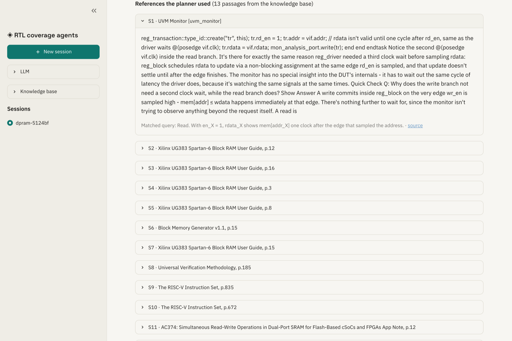
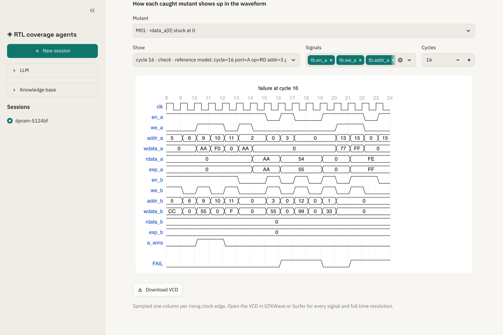
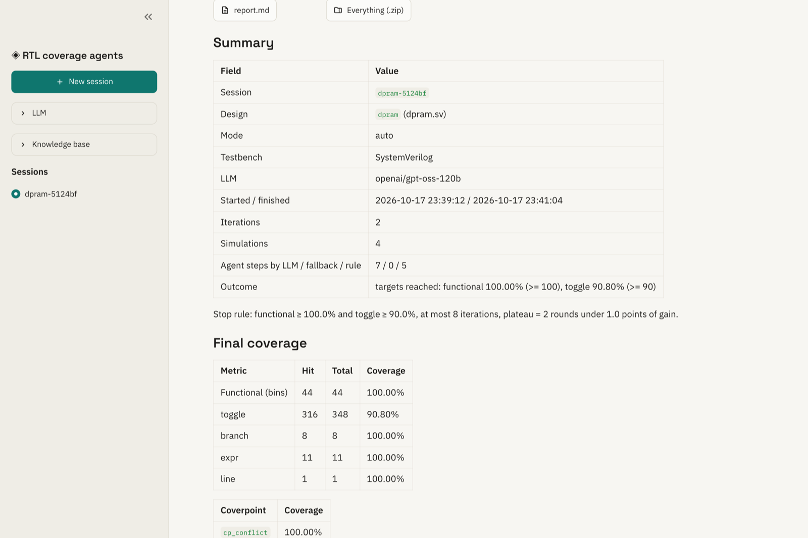
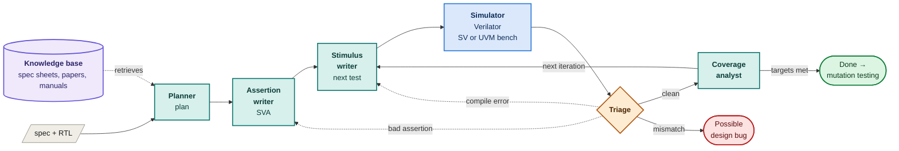

# rtl-coverage-agents

LLM agents that do the core loop of a design-verification (DV) engineer on small SystemVerilog
designs, using the open-source simulator Verilator.

You give it a design (RTL plus a written spec). The agents then:

1. read the spec and search a library of public datasheets and verification papers;
2. write a verification plan;
3. write SystemVerilog assertions;
4. generate test stimulus aimed at whatever is still untested;
5. run the simulator, collecting functional, toggle, branch and expression coverage plus waveforms;
6. triage every failure;
7. stop when coverage is closed;
8. finish with mutation testing: they plant ten known bugs and check how many the tests catch.

Each run can be fully automatic, pause for your approval at every step, or wait for you to run the
simulator yourself. The testbench can be plain SystemVerilog or UVM.


## What this automates, and what it doesn't

A DV engineer's job is to prove a chip design does what its spec says before it is manufactured.
Here is how that job maps onto this project:

| DV engineer's step | Done here by | Automated? |
|---|---|---|
| Read the spec and related material | Planner + knowledge base | yes |
| Write a verification plan | Planner | yes |
| Build the testbench: drivers, reference model, coverage model | a person, once per design (`designs/<name>/harness*.sv`) | **no** |
| Write assertions | Assertion writer | yes, then checked by triage |
| Write tests aimed at coverage holes | Stimulus writer | yes |
| Run simulations | Verilator | yes |
| Debug failures, look at waveforms | Triage (classifies) + Waveforms tab (for you) | partly |
| Decide when coverage is good enough | Coverage analyst | yes |
| Check the tests would catch real bugs | Mutation testing | yes |

So it is not yet "drop in any design and spec sheet". Each design needs a hand-written testbench
template once: how to drive the pins, a reference model that predicts the right outputs, and the
covergroup. After that, every session is the agents' work. See
[Adding a design](#adding-a-design).

## Screenshots

| | |
|---|---|
|  **Setup.** Pick a design, testbench language, mode, knowledge base and stop rule. |  **Live run.** Each agent lights up as it works. |
|  **Plan.** Every feature cites the knowledge-base passages behind it. |  **Approval mode.** Review each new block of stimulus before it runs. |
|  **Coverage.** Functional coverage per coverpoint plus toggle, branch and expression coverage of the RTL. |  **Waveforms.** A failure, with the DUT's outputs next to the reference model's expected values. |
|  **Mutation testing.** Ten planted bugs and what caught each one. |  **Report.** The whole session, downloadable with every waveform. |

## Quick start

You need [uv](https://docs.astral.sh/uv/) and [Verilator](https://verilator.org) 5.052 or newer.

```bash
git clone --recursive https://github.com/Henil-08/rtl-coverage-agents.git   # --recursive pulls the UVM library
cd rtl-coverage-agents
brew install verilator          # macOS; on Linux use your package manager or build from source
uv sync
cp .env.example .env            # put your GROQ_API_KEY here; without it the agents use deterministic fallbacks

# First-time setup: build the knowledge base. Downloads about 275 public documents (~170 MB) and
# indexes them with the UVM library source: about 16,000 passages, 15-20 minutes, all gitignored.
uv run python -m rag build

uv run streamlit run app.py
```

If you cloned without `--recursive`, run `git submodule update --init` before using UVM.

`uv run pytest -q` runs the test suite in about 4 minutes. Every test builds real Verilator
simulations.

## Using it

**Designs.**
- `dpram`: a true dual-port RAM (8-bit × 16, one clock, read-first, port A wins write collisions). The main target.
- `adder4`: a 4-bit ripple-carry adder, used as a quick sanity check.

**Modes**

| Mode | What happens |
|---|---|
| Auto | The agents run everything, the simulator included, and stop on their own. |
| Approval | The loop pauses after the plan, the assertions, each block of stimulus and each result. Approve, reject with feedback (that agent redoes the step), or stop. |
| Manual | The agents write each test. You run the shown `bash …/run.sh` and click "I ran it", and they read the results from the run folder. |

**Testbench language**

| | What the agents write into | Build time |
|---|---|---|
| SystemVerilog | tasks in a module-based testbench with an inline reference model and covergroup | about 2 s |
| UVM | `uvm_sequence` bodies. The bench has a sequence item, sequencer, driver, monitor, scoreboard (reference model), coverage subscriber, env and test. | about 20 s |

Both expose the same stimulus calls and the same covergroup, so coverage and mutation results are
directly comparable. UVM comes from the [verilator/uvm](https://github.com/verilator/uvm) build of
UVM 2020, pinned in `third_party/uvm`.

**When to stop.** The loop ends at the first of these:
- functional coverage reaches its target *and* toggle coverage reaches its target;
- the maximum number of iterations;
- a plateau: for the last N rounds (the plateau window), neither coverage rose by the minimum gain;
- the reference model disagrees with the design. That might be a real design bug, so it stops for a human.

**After a run**

| Tab | Shows |
|---|---|
| Report | everything that happened, as one document. Download `report.md`, or a zip with the session JSON, final testbench, RTL and every waveform. |
| Waveforms | any run, jumping straight to a failure. Download the VCD for GTKWave or Surfer. |
| Mutation testing | runs the ten planted bugs and shows how each caught one appears in the waveform. |
| Coverage | per-coverpoint coverage, uncovered bins and missed toggle/branch points. |

## Knowledge base

`uv run python -m rag build` reads `knowledge/sources.toml` and downloads everything it lists into
`knowledge/docs/`:

- **Standards and manuals.** Accellera's UVM 1.2 User's Guide and Class Reference, the full Verilator
  manual, and the RISC-V ISA manual.
- **Memory datasheets.** Dual-port SRAM collision behaviour (Microchip), Xilinx block RAM read-first
  and write-first modes (Block Memory Generator, Spartan-6 UG383), and Lattice memory usage.
- **Conference papers.** 31 DVCon papers on coverage closure, scoreboards, assertions, formal
  verification, regressions and mutation analysis.
- **Research.** About 90 arXiv papers on LLM-assisted verification, assertion generation, testbench
  generation and coverage closure.
- **Methodology.** OpenTitan's DV methodology docs and tutorial pages on SVA, coverage and UVM.
- **Background.** 79 Wikipedia articles on verification, memories, buses, test and EDA.
- **Local source.** The UVM library in the submodule (168 files), which works as an API reference.

On a full build that comes to about 420 sources and 16,500 passages: 170 MB of documents and a
45 MB index.

It then splits everything into passages that keep their page numbers and builds two indexes:
- **BM25** for keywords;
- **`bge-small-en-v1.5` embeddings** (run locally via fastembed) for meaning.

Searches use both and merge the rankings.

Nothing downloaded is committed: `knowledge/docs/`, `knowledge/index/` and the embedding model are
gitignored, and every document stays under its publisher's licence.

- **Grow it.** Add a line to `sources.toml`, or drop files into `knowledge/docs/` and run
  `uv run python -m rag index`.
- **Search it from the terminal.** `uv run python -m rag search "write collision priority"`.
- **What the planner does with it.** It searches with each behaviour and corner case in the spec,
  reads the best passages and cites them (`S1`, `S2`, …). Every feature in the plan links to a
  passage.

## How it works

```mermaid
flowchart LR
    subgraph Legend
        direction LR
        L1["LLM agent"]:::llm ~~~ L2["Tool"]:::tool ~~~ L3{"Rule"}:::rule ~~~ L4[("Knowledge<br/>base")]:::kb ~~~ L5[/"Input"/]:::input ~~~ L6(["Finish"]):::done ~~~ L7(["Stop for<br/>a human"]):::bad ~~~ E1[" "]:::plain
        E1 -- "main flow" --> E2[" "]:::plain ~~~ E3[" "]:::plain
        E3 -. "lookup / repair" .-> E4[" "]:::plain
    end

    classDef input fill:#efede6,stroke:#8a867b,color:#1c1b19
    classDef kb fill:#efe9fb,stroke:#6250d6,stroke-width:2px,color:#2b2266
    classDef llm fill:#d7f0ec,stroke:#0f766e,stroke-width:2px,color:#0b3b37
    classDef tool fill:#dbe8fb,stroke:#2a78d6,stroke-width:2px,color:#0d2c57
    classDef rule fill:#fdecd2,stroke:#b45309,stroke-width:2px,color:#4a2604
    classDef done fill:#dcf5e3,stroke:#15803d,stroke-width:2px,color:#0d3b1d
    classDef bad fill:#fde2e2,stroke:#b91c1c,stroke-width:2px,color:#5c0d0d
    classDef plain fill:#ffffff,stroke:#8a867b,color:#1c1b19
    style Legend fill:transparent,stroke:#8a867b,stroke-dasharray:4 3
```





In approval mode the loop also pauses after the planner, the assertion writer, every stimulus block
and every analysis. In manual mode the simulator step waits for you to run `run.sh`.

- **Planner.** Turns `spec.md` into features, the coverpoints that measure each one, the bug that
  could hide there, and the knowledge-base passages that support it.
- **Assertion writer.** Writes SVA from the spec and the plan only. It never sees the stimulus, so
  its assertions can't simply echo the tests.
- **Stimulus writer.** Writes the next block of stimulus, aimed at uncovered bins, missed
  toggle/branch/expression points and the analyst's advice. Iterations accumulate: each run replays
  every earlier block, so coverage always describes the whole suite.
- **Simulator.** Not an LLM. The steps are:
  1. write `run.sh`;
  2. run `verilator --binary --timing --coverage --assert --trace`, with the UVM package added for UVM benches;
  3. run the binary;
  4. parse the log (failures with timestamps), `coverage.dat` (every bin and code-coverage point) and `wave.vcd`.
- **Triage.** Fixed rules, with an LLM explanation for mismatches:
  - a compile error goes back to whichever writer caused it;
  - an assertion that fires while the reference model is clean is a wrong assertion, so it's repaired once, then dropped;
  - a reference-model mismatch stops the loop as a possible design bug.
- **Coverage analyst.** Applies the stop rule above. Otherwise it names the next thing to cover.

Everything runs as a LangGraph state machine, checkpointed to SQLite. Sessions survive restarts and
are shared between the Streamlit app and the MCP server.

## Results

Runs without an LLM (deterministic fallback generators), from `uv run python -m agent.bench --mutants`.
The curves are in `bench/`.

| Design | Run | Stimulus to 100% functional coverage | Mutants caught |
|---|---|---|---|
| dpram | agent | 43 cycles (toggle ≥ 90% at 123) | 9/10 (M10 survives) |
| dpram | random, 5 seeds | not reached within 320 cycles on any seed | 10/10 on 4 seeds, 9/10 on 1 |
| adder4 | agent | 16 vectors | 10/10 |
| adder4 | random, 5 seeds | 136 vectors on 1 seed, not reached within 160 on the other 4 | 10/10 |

- **Closing coverage.** Directed stimulus closes functional coverage much faster than random
  stimulus, which keeps missing exact corners such as 0x00/0xFF writes and same-address collisions.
- **Catching bugs.** On the RAM, random stimulus catches more mutants. M10 is a collision compare
  that ignores the top address bit. Only writes to two addresses that differ in that bit expose it,
  and no coverage bin asks for that. So 100% functional coverage does not mean every bug is found:
  the coverage model has a hole.
- **With an LLM** (Groq `openai/gpt-oss-120b`), results vary from run to run.
  - **Planner.** It used the knowledge base to add risks the spec never states, such as
    write-through and address wrap.
  - **Assertion writer.** Several of its assertions fired on the correct design. Triage caught and
    dropped them.
  - **Mutation testing.** Suites caught 9/10 mutants. Most catches came from the reference model,
    not from the LLM's assertions.

## Adding a design

Create `designs/<name>/` with:

| File | Contents |
|---|---|
| `<name>.sv` | the RTL |
| `spec.md` | the spec in plain English, with a "Behaviour" list and an "Interesting cases" list. The planner queries the knowledge base with these. |
| `harness.sv` | the SystemVerilog testbench template: driver tasks, reference model, covergroup, and `// @ASSERTIONS`, `// @STIMULUS_TASKS`, `// @STIMULUS_CALLS` markers. Optionally add `harness_uvm.sv` with `// @SEQUENCES` and `// @SEQUENCE_CALLS`. |
| `__init__.py` | a `Design` with the driver task names, the signals assertions may use, ten mutants (find/replace edits of the RTL), a fallback generator and a random generator |

Then register it in `designs/__init__.py`. Writing the reference model and covergroup is the part
that still needs a DV engineer.

## Hardware background

- **RTL.** The hardware description (here SystemVerilog) that eventually becomes a chip.
- **DUT.** The design under test.
- **Testbench.** Code around the DUT that drives inputs and checks outputs. It never becomes hardware.
- **Reference model / scoreboard.** A simple model that predicts the correct output for every input.
  A mismatch means a bug somewhere.
- **SVA.** SystemVerilog Assertions: rules checked every clock, e.g. `!en_a |=> $stable(rdata_a)`
  (if port A is idle, its read data must not change on the next cycle).
- **Functional coverage.** A `covergroup` lists behaviours that must be seen at least once, each as a
  *bin*. Examples: both ports writing the same address in one cycle; reading the last address;
  writing 0xAA.
- **Code coverage.** Did every signal bit toggle both ways (toggle), every `if` go both ways
  (branch), and every expression see each input combination (expression)?
- **Waveform.** Every signal's value over time, viewed like an oscilloscope. It's how engineers debug
  a failure.
- **Mutation testing.** Plant a known bug (stuck-at, inverted condition, off-by-one), rerun the suite,
  and see whether it fails. Coverage says the tests *exercised* the design; mutation testing shows
  they would *notice* a bug.
- **Read-first / write-first.** Whether a port that reads an address being written in the same cycle
  returns the old or the new value. This RAM is read-first.
- **Tapeout.** Sending the final design to the factory. Bugs found after it are expensive, which is
  why this work matters.

## MCP server

```bash
uv run python -m mcp_server.server
claude mcp add rtl-coverage -- uv run --directory /abs/path/rtl-coverage-agents python -m mcp_server.server
```

| Tool | Purpose |
|---|---|
| `list_designs`, `describe_design` | spec, RTL, covergroup and how to drive each design |
| `simulate(design, stimulus, assertions, language)` | run your own stimulus and assertions on Verilator and get coverage back |
| `start_session(design, mode, language, ...)`, `get_session`, `respond` | run the built-in agents and answer them at review gates |
| `run_mutation_testing(session_id)` | score a session's suite against its mutants |

An MCP client such as Claude Code can let the built-in agents work, or act as the test writer itself
through `simulate`.

## Layout

```
designs/<name>/        RTL, spec.md, testbench templates (harness.sv, harness_uvm.sv), mutants, generators
agent/nodes.py         the agents and review gates
agent/graph.py         LangGraph wiring
agent/sim.py           Verilator runner, coverage.dat and failure parsing
agent/wave.py          VCD reader and WaveDrom rendering
agent/mutation.py      parallel mutation runs
agent/report.py        session report and download bundle
agent/service.py       session API shared by the UI and the MCP server
agent/bench.py         agent vs random benchmark
rag/                   knowledge base: fetch, chunk, BM25 + embedding index, search
knowledge/sources.toml where the knowledge base comes from
app.py, ui.py          Streamlit UI
mcp_server/server.py   MCP tools
third_party/uvm        UVM library (git submodule)
```

## Limitations

- **Testbench template per design.** Each design needs one written by hand (see above). Generating
  that from a spec is the obvious next step.
- **Small designs.** The adder has only 512 possible inputs, so testing all of them beats any agent.
  The RAM is where directed stimulus matters.
- **Verilator coverage gaps.** Covergroup support in Verilator is recent. Per-coverpoint
  `get_inst_coverage()` isn't supported, so coverage is read from `coverage.dat`.
- **Slow UVM builds.** About 20 seconds each. ccache can't help, because Verilator's precompiled
  headers keep the path of the folder that built them.
- **Waveform resolution.** The viewer samples one column per rising clock edge; the VCD download has
  full resolution.
- **Blocked vendor downloads.** AMD and Intel block scripted downloads. Put their PDFs in
  `knowledge/docs/` by hand and run `uv run python -m rag index`.
- **Rate limits.** Groq's free tier rate-limits quickly. The agents back off, retry, then fall back
  to the deterministic generators, and the trace says when.
