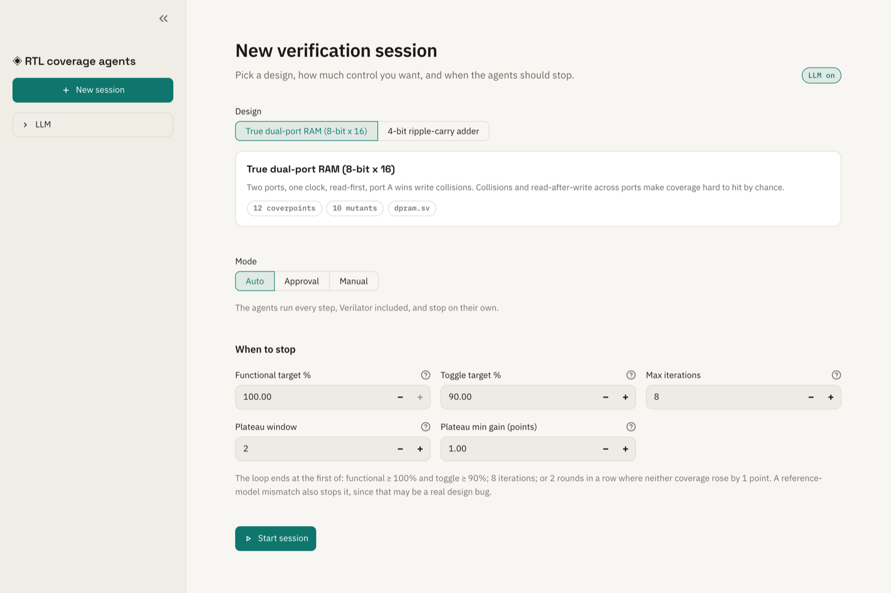
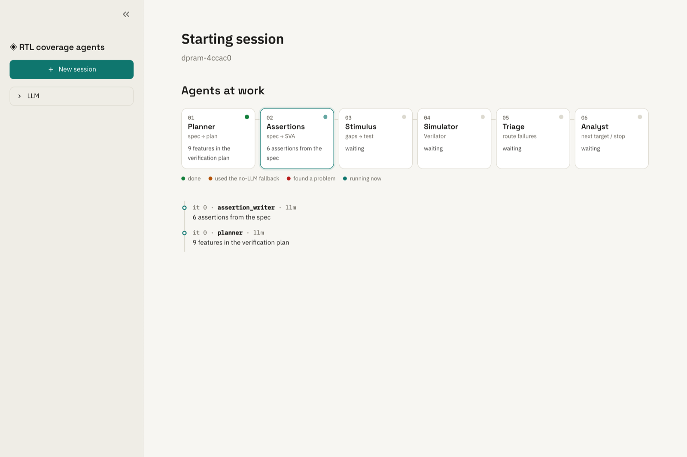
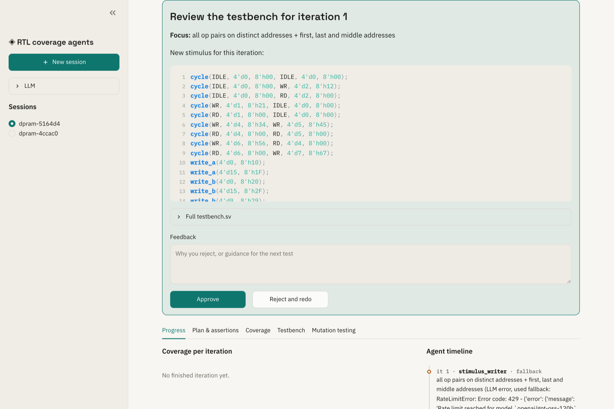
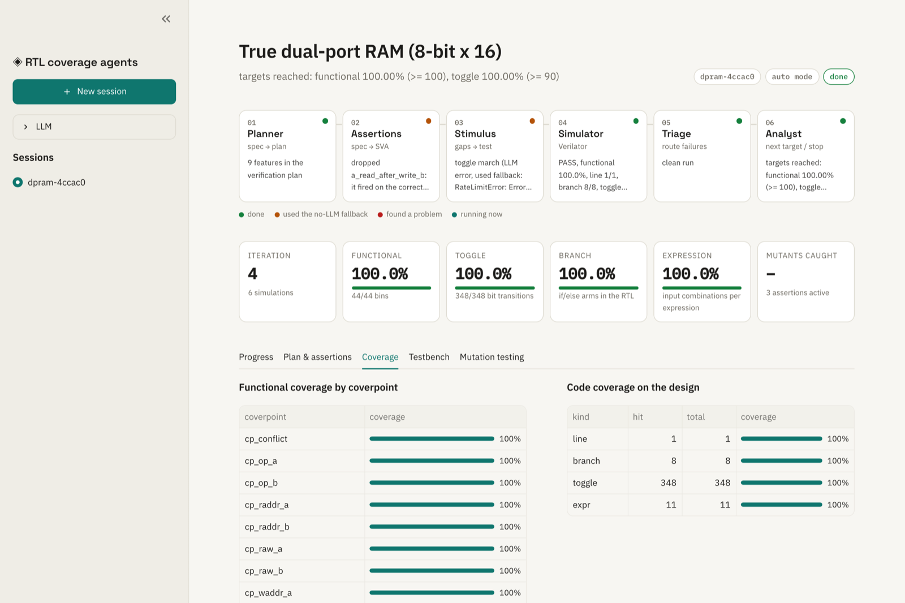
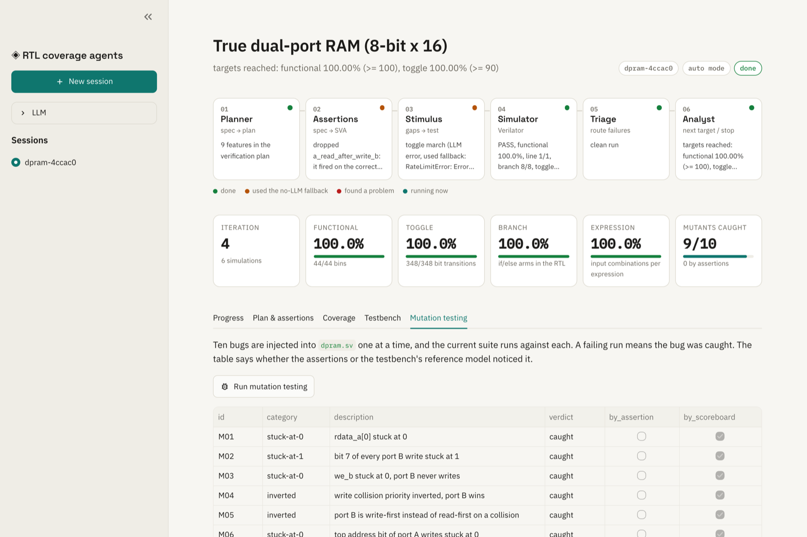

# AI-in-Hardware: coverage-guided verification agents

A group of LLM agents verifies small SystemVerilog designs on Verilator. They read the spec, write a
verification plan and assertions, generate stimulus aimed at coverage holes, run the simulator, triage
failures, and decide when coverage is good enough. Mutation testing then checks whether the resulting
suite actually catches bugs.

Two designs are included:

- `dpram`: a true dual-port RAM (8-bit × 16, one clock, read-first, port A wins write collisions). This is the main target.
- `adder4`: a 4-bit ripple-carry adder, kept as a quick sanity check.


## Screenshots

| | |
|---|---|
|  **Setup.** Pick a design, a mode and the stop rule. |  **Live run.** Each agent lights up as it works. |
|  **Approval mode.** Review each new stimulus block before it runs. |  **Coverage.** Functional coverage per coverpoint, plus toggle, branch and expression coverage of the RTL. |
|  **Mutation testing.** Ten injected bugs, and whether the assertions or the reference model caught each one. |  **Dark theme.** |

These come from a real run with Groq's `openai/gpt-oss-120b`, so they include its mistakes: an
assertion that triage dropped after it fired on the correct design, and steps that fell back to the
deterministic generator when Groq's free-tier rate limit hit.

## Setup

Needs [uv](https://docs.astral.sh/uv/) and [Verilator](https://verilator.org) 5.050 or newer (covergroup support).

```bash
brew install verilator          # macOS; on Linux use your package manager or build from source
uv sync
cp .env.example .env            # add GROQ_API_KEY; without it every agent uses a deterministic fallback
uv run pytest -q                # about 2 minutes; every test runs real Verilator builds
uv run streamlit run app.py
```

## Modes

| Mode | What happens |
|------|--------------|
| auto | The agents run the whole loop, simulator included, and stop on their own. |
| approval | The loop pauses for your OK on the plan, the assertions, each testbench and each result. Rejecting with feedback makes that agent redo the step. |
| manual | The agents write each test, and you run the generated `run.sh` yourself. The agents then read the logs and `coverage.dat` from the run folder. |

## How it works

```
planner ─► assertion_writer ─► stimulus_writer ─► simulator ─► triage ─► coverage_analyst ─┐
   ▲             ▲  ▲                ▲  ▲                         │  │                       │
   └ reject      │  └── assertion fired on a clean run / bad SVA ─┘  │                       │
                 └ reject            │  └── stimulus did not compile ┘                       │
                                     └──────────────────── next iteration ──────────────────┘
```

Every arrow out of an LLM step passes through a review gate. Gates pause only in approval mode.

- **Planner** turns `spec.md` into a list of features, the coverpoints that measure each one, and the bug that could hide there.
- **Assertion writer** writes SVA from the spec and the plan only. It never sees the stimulus, so it
  can't write checks that just echo the tests.
- **Stimulus writer** writes the next block of stimulus. Its input is the uncovered bins, the missed
  toggle/branch/expression points and the analyst's guidance.
- **Simulator** is a tool, not an LLM: `verilator --binary --timing --coverage --assert`, then the
  run log and `coverage.dat` are parsed. Functional coverage is computed per bin; code coverage is
  filtered to the design under test.
- **Triage** routes problems:
  - compile errors go back to whichever writer caused them;
  - an assertion that fires while the reference model is clean is treated as a wrong assertion and is
    repaired once, then dropped;
  - a reference-model mismatch stops the loop as a possible design bug.
- **Coverage analyst** stops the loop when functional and toggle targets are both met, coverage
  plateaus, or the iteration limit is reached. Otherwise it names the next thing to cover.

The testbench template, the covergroup and the reference model never change. Each iteration's stimulus
is kept and replayed, so coverage always describes the whole suite.

## Hardware background

**Design under test (DUT).** The RTL being verified. The testbench drives its inputs, and a reference
model (written in plain SystemVerilog inside the testbench) predicts what the outputs should be.

**Functional coverage.** A `covergroup` lists behaviours you want to see at least once, each as a
*bin*. For the RAM, examples are:
- both ports writing the same address in the same cycle;
- reading address 15 on port B;
- writing 0xAA;
- reading a word the other port wrote in the previous cycle.

Coverage % tells you how much of that list the tests have exercised.

**Code coverage.** Verilator counts:
- whether each signal bit toggled 0→1 and 1→0 (toggle);
- whether each `if` went both ways (branch);
- which input combinations each expression saw (expression).

It measures the RTL, not the intent, so it complements functional coverage.

**SVA (SystemVerilog Assertions).** Rules checked on every clock edge, for example
`!en_a |=> $stable(rdata_a)`: if port A is idle, its read data must not change on the next cycle.

**Mutation testing.** Inject a known bug (a stuck-at fault, an inverted condition, an off-by-one),
rerun the suite, and see whether it fails. Coverage says the tests *exercised* the design; mutation
testing shows they would *notice* a bug.

**Read-first / write-first.** When one port reads an address that is being written in the same cycle,
a read-first RAM returns the old value and a write-first RAM returns the new one. FPGA block RAMs
offer both; this design is read-first.

## Results so far

Runs without an LLM (deterministic fallback generators), from `uv run python -m agent.bench --mutants`.
The CSVs are in `bench/`.

| Design | Run | Stimulus to 100% functional | Mutants caught |
|--------|-----|-----------------------------|----------------|
| dpram | agent | 43 cycles (toggle ≥ 90% at 123) | 9/10 (M10 survives) |
| dpram | random, 5 seeds | not reached within 320 cycles on any seed | 10/10 on 4 seeds, 9/10 on 1 |
| adder4 | agent | 16 vectors | 10/10 |
| adder4 | random, 5 seeds | 136 vectors on 1 seed, not reached within 160 on the other 4 | 10/10 |

What the numbers say:

- **Closing coverage.** Directed stimulus closes functional coverage far faster than random stimulus,
  which keeps missing exact corners such as 0x00/0xFF writes and same-address collisions.
- **Catching bugs.** On the RAM, random stimulus catches more mutants. M10 is a collision compare
  that ignores the top address bit. It only shows up when both ports write addresses that differ in
  that bit, and no coverage bin asks for that, so 100% functional coverage does not mean every bug
  is found. The coverage model has a hole there.
- **LLM-written assertions.** In one LLM run (Groq, `openai/gpt-oss-120b`), the assertion writer
  produced 7 assertions for the RAM. Triage found 5 of them firing on the correct design, repaired
  some, and dropped the ones it couldn't fix. The final suite caught 9/10 mutants, all through the
  reference model and none through the surviving assertions. Results with an LLM vary from run to
  run, so rerun the benchmark with `--llm` before quoting numbers.

## MCP server

```bash
uv run python -m mcp_server.server
```

| Tool | Purpose |
|------|---------|
| `list_designs`, `describe_design` | spec, RTL, covergroup and how to drive each design |
| `simulate(design, stimulus, assertions)` | run your own stimulus and assertions on Verilator, get coverage back |
| `start_session`, `get_session`, `respond` | run the built-in agents and answer them at review gates |
| `run_mutation_testing(session_id)` | score a session's suite against its mutants |

To add it to Claude Code:

```bash
claude mcp add rtl-coverage -- uv run --directory /abs/path/AI-in-Hardware python -m mcp_server.server
```

An MCP client can let the built-in agents work, or act as the test writer itself with `simulate`.
Sessions are stored in `data/sessions.sqlite` and are shared with the Streamlit app.

## Layout

```
designs/<name>/        RTL, spec.md, testbench template (harness.sv), mutants, fallback generator
agent/sim.py           Verilator runner and coverage.dat parser
agent/nodes.py         agent nodes and review gates
agent/graph.py         LangGraph wiring
agent/service.py       session API used by the UI and the MCP server
agent/mutation.py      parallel mutation runs
agent/bench.py         agent vs random benchmark
app.py                 Streamlit UI
mcp_server/server.py   MCP tools
```

## Limitations

- Verilator's covergroup support is recent. Per-coverpoint `get_inst_coverage()` is not supported, so
  coverage is read from `coverage.dat` instead.
- The designs are small on purpose. The adder has only 512 possible inputs, so testing all of them
  beats any agent. The RAM is where coverage-directed stimulus matters.
- Groq's free tier rate-limits quickly. The agents back off and retry, then fall back to deterministic
  generators. The trace shows when that happened.
