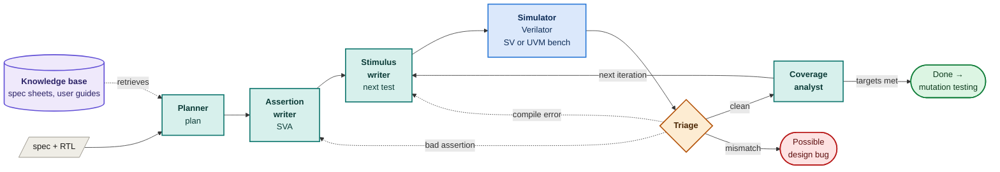

# AI-in-Hardware: coverage-guided verification agents

A group of LLM agents verifies small SystemVerilog designs on Verilator. They read the spec (and, for
the planner, a searchable knowledge base of public datasheets), write a verification plan and
assertions, generate stimulus aimed at coverage holes, run the simulator with either a plain
SystemVerilog or a UVM testbench, triage failures, and decide when coverage is good enough. Mutation
testing then checks whether the resulting suite actually catches bugs. Every run keeps its waveform,
and a full report of the session can be downloaded.

Two designs are included:

- `dpram`: a true dual-port RAM (8-bit × 16, one clock, read-first, port A wins write collisions). This is the main target.
- `adder4`: a 4-bit ripple-carry adder, kept as a quick sanity check.


## Screenshots

| | |
|---|---|
|  **Setup.** Pick a design, a mode and the stop rule. |  **Live run.** Each agent lights up as it works. |
|  **Approval mode.** Review each new stimulus block before it runs. |  **Coverage.** Functional coverage per coverpoint, plus toggle, branch and expression coverage of the RTL. |
|  **Mutation testing.** Ten injected bugs, and whether the assertions or the reference model caught each one. |  **Waveforms.** A caught mutant: `rdata_a` differs from the reference model's `exp_a` at the marked cycle. |
|  **Report.** Everything that happened in the session, downloadable with all waveforms. |  **Dark theme.** |

These come from a real run with Groq's `openai/gpt-oss-120b`, so they include its mistakes: an
assertion that triage dropped after it fired on the correct design, and steps that fell back to the
deterministic generator when Groq's free-tier rate limit hit.

## Setup

Needs [uv](https://docs.astral.sh/uv/) and [Verilator](https://verilator.org) 5.052 or newer
(covergroups, and UVM 2020 support).

```bash
git clone --recursive https://github.com/Henil-08/rtl-coverage-agents.git   # --recursive pulls the UVM library
cd rtl-coverage-agents                  # already cloned? run: git submodule update --init
brew install verilator                  # macOS; on Linux use your package manager or build from source
uv sync
cp .env.example .env                    # add GROQ_API_KEY; without it every agent uses a deterministic fallback
uv run python -m rag build              # optional: fetch and index the knowledge base (about a minute)
uv run pytest -q                        # about 4 minutes; every test runs real Verilator builds
uv run streamlit run app.py
```

## Testbench languages

| Language | What the agents write into | Build time |
|----------|----------------------------|------------|
| SystemVerilog | tasks in a module-based bench with an inline reference model and covergroup | about 2 s |
| UVM | `uvm_sequence` bodies. The bench has a sequence item, sequencer, driver, monitor, scoreboard (reference model), coverage subscriber, env and test. | about 20 s |

Both benches expose the same stimulus calls (`cycle(...)`, `write_a(...)`, `apply(...)`) and the same
covergroup, so the agents, coverage numbers and mutation results are directly comparable. UVM comes
from the [verilator/uvm](https://github.com/verilator/uvm) fork of UVM 2020, pinned as a submodule
in `third_party/uvm` and compiled without DPI.

## Knowledge base

`knowledge/sources.toml` lists public documents: dual-port SRAM collision behaviour, block RAM
read-first and write-first modes, the UVM user's guide, Verilator's coverage manual and a few
background articles. `uv run python -m rag build` downloads them into `knowledge/docs/`, which is not
committed because each document stays under its publisher's licence. It then splits them into
passages that keep their page numbers and indexes them twice: BM25 for keywords and
`bge-small-en-v1.5` embeddings (local, via fastembed) for meaning. The two rankings are fused.

The planner searches the index with each behaviour and corner case in the design's spec, reads the
best passages, and cites them in the plan as `S1`, `S2`, and so on. The Plan tab shows each cited
passage. Some vendor portals (AMD, Intel) block scripted downloads; save those PDFs into
`knowledge/docs/` by hand and run `uv run python -m rag index`. To test retrieval from the command
line, use `uv run python -m rag search "write collision"`.

## Waveforms and the report

Every simulation is built with `--trace` and leaves a `wave.vcd`. Every reference-model mismatch and
assertion failure is logged with its timestamp.

- **Waveforms tab.** Pick any run and jump to a failure. A window of cycles is drawn with the design's
  ports next to the reference model's expected values, so you can see where they diverge. Download
  the VCD to open in GTKWave or Surfer.
- **Mutation tab.** Shows the same view for every caught mutant.
- **Report tab.** The whole session as one document: the plan and its sources, every iteration (with
  its stimulus, runs, triage notes and newly covered bins), assertion history, every failure,
  remaining gaps, mutation results and the agent trace. "Everything (.zip)" adds the session JSON,
  the final testbench, the RTL and all waveforms.

## Modes

| Mode | What happens |
|------|--------------|
| auto | The agents run the whole loop, simulator included, and stop on their own. |
| approval | The loop pauses for your OK on the plan, the assertions, each testbench and each result. Rejecting with feedback makes that agent redo the step. |
| manual | The agents write each test, and you run the generated `run.sh` yourself. The agents then read the logs and `coverage.dat` from the run folder. |

## How it works



Teal boxes are LLM agents, blue is the simulator tool, orange is rule-based triage, and purple is the
knowledge base. Dotted arrows are lookups and repairs.

In approval mode the loop also pauses after the planner, the assertion writer, every stimulus block and every analysis, so you can approve or reject with feedback. In manual mode the simulator step waits for you to run `run.sh`.

- **Planner** turns `spec.md` into a list of features, the coverpoints that measure each one, and
  the bug that could hide there. It also pulls related passages from the knowledge base and cites them.
- **Assertion writer** writes SVA from the spec and the plan only. It never sees the stimulus, so it
  can't write checks that just echo the tests.
- **Stimulus writer** writes the next block of stimulus. Its input is the uncovered bins, the missed
  toggle/branch/expression points and the analyst's guidance.
- **Simulator** is a tool, not an LLM: `verilator --binary --timing --coverage --assert`, then the
  run log and `coverage.dat` are parsed. Functional coverage is computed per bin; code coverage is
  filtered to the design under test.
- **Triage** routes problems:
  - compile errors go back to whichever writer caused them;
  - an assertion that fires while the reference model is clean is treated as a wrong assertion and is
    repaired once, then dropped;
  - a reference-model mismatch stops the loop as a possible design bug.
- **Coverage analyst** stops the loop when functional and toggle targets are both met, coverage
  plateaus, or the iteration limit is reached. Otherwise it names the next thing to cover.

The testbench template, the covergroup and the reference model never change. Each iteration's stimulus
is kept and replayed, so coverage always describes the whole suite.

## Hardware background

**Design under test (DUT).** The RTL being verified. The testbench drives its inputs, and a reference
model (written in plain SystemVerilog inside the testbench) predicts what the outputs should be.

**Functional coverage.** A `covergroup` lists behaviours you want to see at least once, each as a
*bin*. For the RAM, examples are:
- both ports writing the same address in the same cycle;
- reading address 15 on port B;
- writing 0xAA;
- reading a word the other port wrote in the previous cycle.

Coverage % tells you how much of that list the tests have exercised.

**Code coverage.** Verilator counts:
- whether each signal bit toggled 0→1 and 1→0 (toggle);
- whether each `if` went both ways (branch);
- which input combinations each expression saw (expression).

It measures the RTL, not the intent, so it complements functional coverage.

**SVA (SystemVerilog Assertions).** Rules checked on every clock edge, for example
`!en_a |=> $stable(rdata_a)`: if port A is idle, its read data must not change on the next cycle.

**Mutation testing.** Inject a known bug (a stuck-at fault, an inverted condition, an off-by-one),
rerun the suite, and see whether it fails. Coverage says the tests *exercised* the design; mutation
testing shows they would *notice* a bug.

**Read-first / write-first.** When one port reads an address that is being written in the same cycle,
a read-first RAM returns the old value and a write-first RAM returns the new one. FPGA block RAMs
offer both; this design is read-first.

## Results so far

Runs without an LLM (deterministic fallback generators), from `uv run python -m agent.bench --mutants`.
The CSVs are in `bench/`.

| Design | Run | Stimulus to 100% functional | Mutants caught |
|--------|-----|-----------------------------|----------------|
| dpram | agent | 43 cycles (toggle ≥ 90% at 123) | 9/10 (M10 survives) |
| dpram | random, 5 seeds | not reached within 320 cycles on any seed | 10/10 on 4 seeds, 9/10 on 1 |
| adder4 | agent | 16 vectors | 10/10 |
| adder4 | random, 5 seeds | 136 vectors on 1 seed, not reached within 160 on the other 4 | 10/10 |

What the numbers say:

- **Closing coverage.** Directed stimulus closes functional coverage far faster than random stimulus,
  which keeps missing exact corners such as 0x00/0xFF writes and same-address collisions.
- **Catching bugs.** On the RAM, random stimulus catches more mutants. M10 is a collision compare
  that ignores the top address bit. It only shows up when both ports write addresses that differ in
  that bit, and no coverage bin asks for that, so 100% functional coverage does not mean every bug
  is found. The coverage model has a hole there.
- **LLM-written assertions.** In one LLM run (Groq, `openai/gpt-oss-120b`), the assertion writer
  produced 7 assertions for the RAM. Triage found 5 of them firing on the correct design, repaired
  some, and dropped the ones it couldn't fix. The final suite caught 9/10 mutants, all through the
  reference model and none through the surviving assertions. Results with an LLM vary from run to
  run, so rerun the benchmark with `--llm` before quoting numbers.

## MCP server

```bash
uv run python -m mcp_server.server
```

| Tool | Purpose |
|------|---------|
| `list_designs`, `describe_design` | spec, RTL, covergroup and how to drive each design |
| `simulate(design, stimulus, assertions, language)` | run your own stimulus and assertions on Verilator in the SV or UVM bench, get coverage back |
| `start_session(design, mode, language, ...)`, `get_session`, `respond` | run the built-in agents and answer them at review gates |
| `run_mutation_testing(session_id)` | score a session's suite against its mutants |

To add it to Claude Code:

```bash
claude mcp add rtl-coverage -- uv run --directory /abs/path/AI-in-Hardware python -m mcp_server.server
```

An MCP client can let the built-in agents work, or act as the test writer itself with `simulate`.
Sessions are stored in `data/sessions.sqlite` and are shared with the Streamlit app.

## Layout

```
designs/<name>/        RTL, spec.md, testbench templates (harness.sv, harness_uvm.sv), mutants, fallback generator
agent/sim.py           Verilator runner, coverage.dat and failure parsing
agent/wave.py          VCD reader and WaveDrom rendering
agent/nodes.py         agent nodes and review gates
agent/graph.py         LangGraph wiring
agent/service.py       session API used by the UI and the MCP server
agent/mutation.py      parallel mutation runs
agent/bench.py         agent vs random benchmark
agent/report.py        session report and download bundle
rag/                   knowledge base: fetch, chunk, BM25 + embedding index, search
knowledge/sources.toml public documents the knowledge base is built from
third_party/uvm        UVM library (git submodule)
app.py                 Streamlit UI
mcp_server/server.py   MCP tools
```

## Limitations

- Verilator's covergroup support is recent. Per-coverpoint `get_inst_coverage()` is not supported, so
  coverage is read from `coverage.dat` instead.
- The designs are small on purpose. The adder has only 512 possible inputs, so testing all of them
  beats any agent. The RAM is where coverage-directed stimulus matters.
- UVM builds take about 20 seconds each on Verilator, so a UVM session or mutation run is roughly ten
  times slower than the SystemVerilog bench. ccache can't help: Verilator's precompiled headers keep
  the absolute path of the folder that built them, and every run here builds in its own folder.
- The waveform viewer samples one column per rising clock edge. Use the VCD download for full time
  resolution.
- Groq's free tier rate-limits quickly. The agents back off and retry, then fall back to deterministic
  generators. The trace shows when that happened.
