# rtl-coverage-agents

LLM agents that run the design-verification (DV) flow on SystemVerilog designs, using the open-source
simulator Verilator. Upload RTL and a spec, and the agents:

1. read the spec, along with a library of public datasheets and verification papers;
2. write a verification plan;
3. **write the testbench**: driver tasks, a reference model and a coverage model, in plain
   SystemVerilog or full UVM;
4. write assertions;
5. generate tests aimed at whatever is still untested;
6. run Verilator, collecting functional, toggle, branch and expression coverage and waveforms;
7. triage every failure;
8. stop when coverage is closed;
9. finally plant ten bugs (mutation testing) to check that the tests would catch them.

Everything streams live into a React UI as it happens. Any agent can use any model: Groq, Anthropic
(Claude), OpenAI, a local model through Ollama or LM Studio, or **Claude Code itself over MCP**,
with no API key.

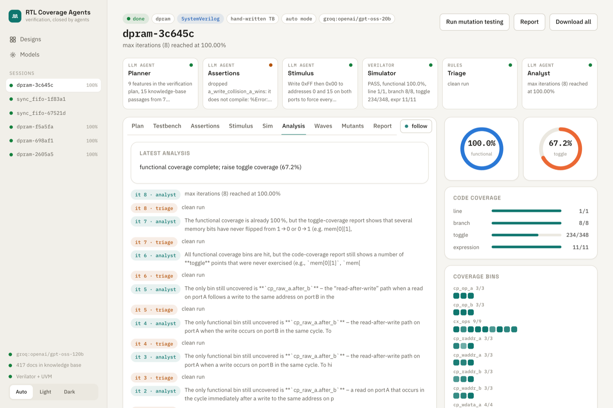

## The DV flow, and who does each step

| DV engineer's step | Here |
|---|---|
| Read the spec | Planner, with a knowledge base of about 420 public documents |
| Write the test plan | Planner (features, coverpoints, risks, cited sources) |
| Write the testbench in SV / UVM | **Testbench architect**, checked by five gates, or a hand-written testbench |
| Write tests, find bugs | Assertion writer + stimulus writer, Verilator, triage |
| Functional and code coverage | Verilator `--coverage`, coverage analyst |
| Sign-off | Stop rule (targets, plateau, iteration cap) + mutation score + report |

## Screenshots

| | |
|---|---|
| 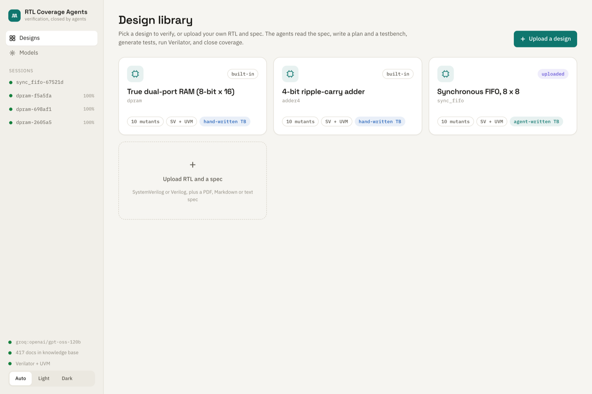 **Design library.** Built-in designs, your uploads, and an upload card. | 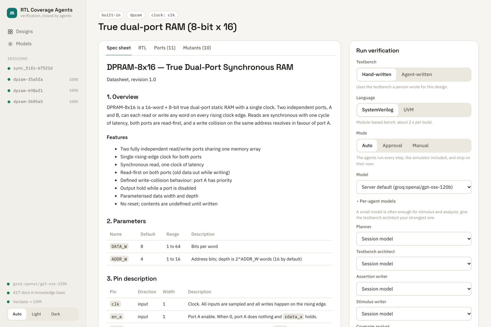 **Design page.** Spec sheet with timing diagrams; pick testbench source, language, model and mode. |
| 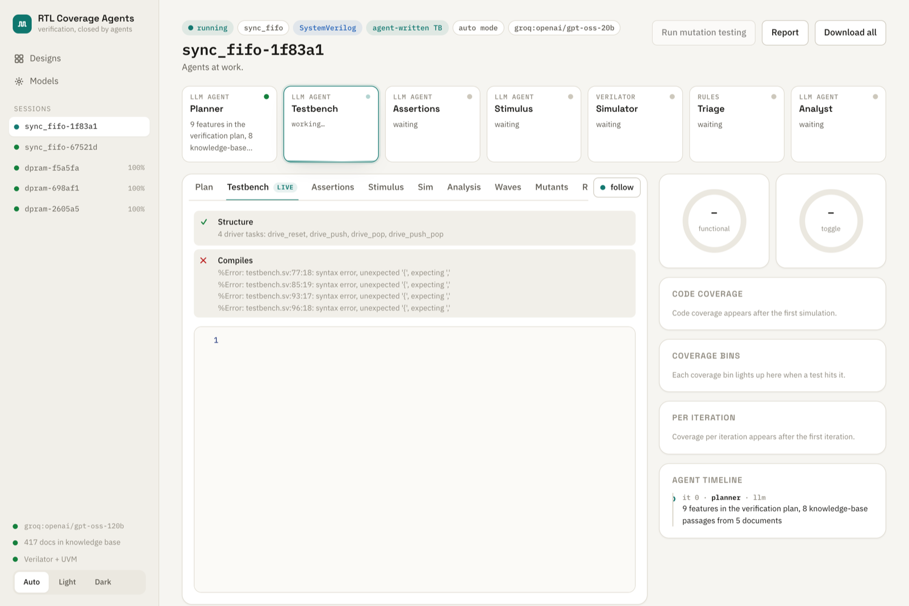 **Testbench architect.** Each gate reports as it runs; here a small model fails the compile gate and gets the errors back to fix. | 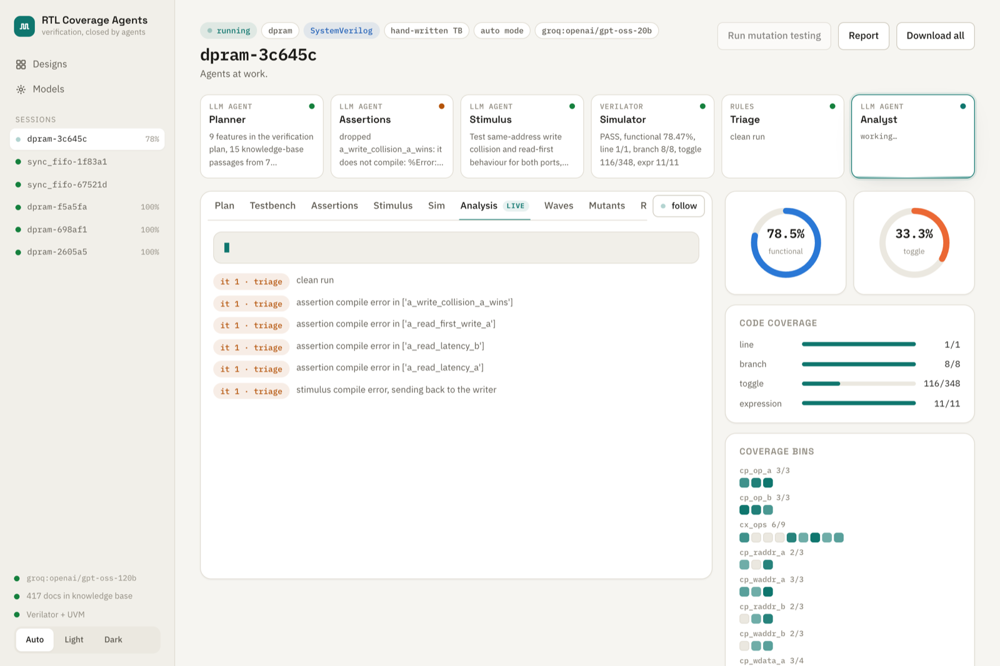 **Live simulator.** Verilator output streams while bins light up. |
| 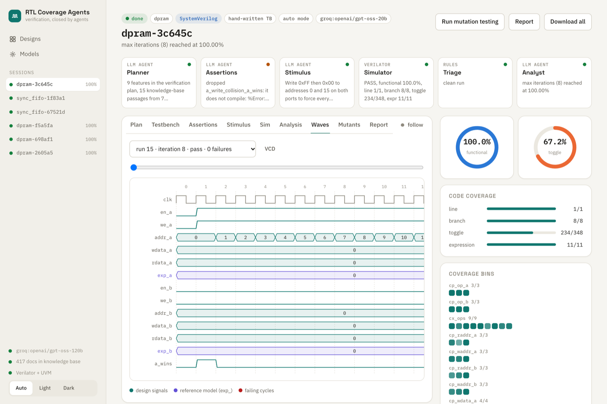 **Waveforms.** DUT outputs next to the reference model (violet); failing cycles in red. | 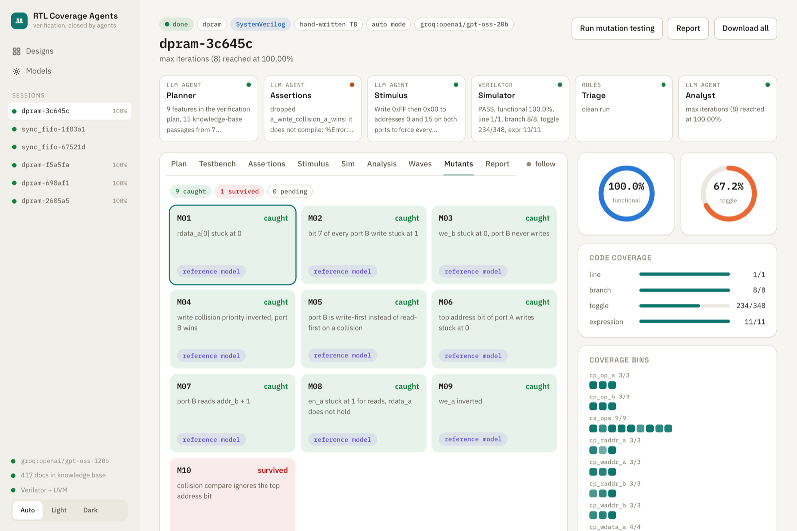 **Mutation testing.** Cards flip to caught or survived as each mutant finishes. |
| 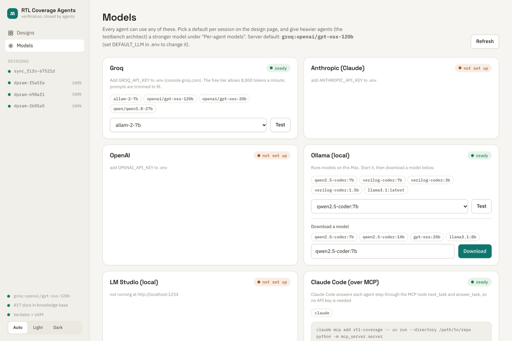 **Models.** Cloud and local providers; download Ollama models in the app. | 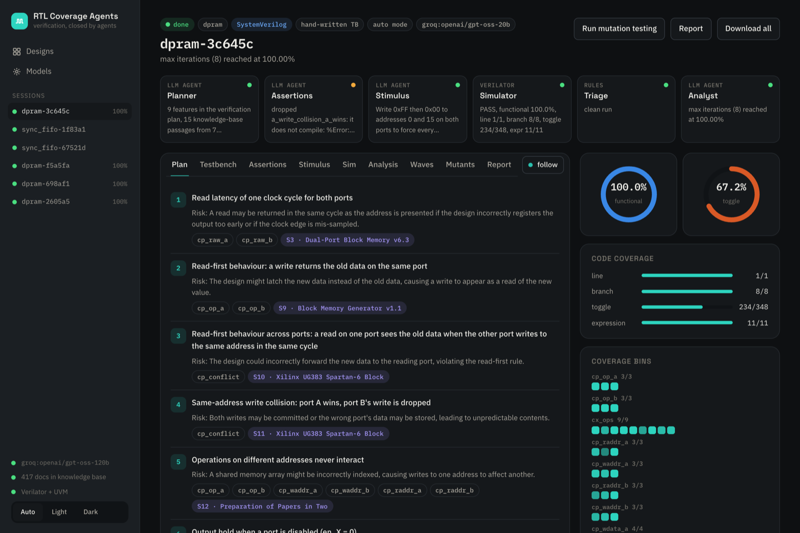 **Dark theme.** |

## Quick start

You need [uv](https://docs.astral.sh/uv/), [Node 20+](https://nodejs.org) and
[Verilator](https://verilator.org) 5.052 or newer.

```bash
git clone --recursive https://github.com/Henil-08/rtl-coverage-agents.git   # --recursive pulls the UVM library
cd rtl-coverage-agents
brew install verilator                 # macOS; on Linux use your package manager or build from source
uv sync
cp .env.example .env                   # add at least one model provider (see "Models")
(cd frontend && npm install && npm run build)

# First-time setup: the knowledge base. Downloads about 275 public documents (~170 MB), indexes them with the
# UVM library source (~16,500 passages), takes 15-20 minutes, and stays out of git.
uv run python -m rag build

uv run python -m server                # open http://localhost:8000
```

If you cloned without `--recursive`, run `git submodule update --init` before using UVM.

To work on the frontend, run `uv run python -m server` in one terminal and `cd frontend && npm run dev`
in another (http://localhost:5173, proxied to the API). `uv run pytest -q` runs the test suite in
about six minutes, with real Verilator builds throughout.

## Models

Pick a model per session on the design page, and optionally a different one per agent. A small model
is fine for analysis; the testbench architect needs your strongest one.

| Provider | Setup | Notes |
|---|---|---|
| Groq | `GROQ_API_KEY` in `.env` | Fast. The free tier allows 8,000 tokens a minute and 200,000 a day **per model**. The agents trim prompts to fit, wait out short limits, and report a used-up daily quota instead of hanging. |
| Anthropic (Claude) | `ANTHROPIC_API_KEY` | `claude-opus-5-5`, `claude-sonnet-5-5`, `claude-haiku-5-5` |
| OpenAI | `OPENAI_API_KEY` | Models are listed from your account. |
| Ollama (local) | Install [Ollama](https://ollama.com) | Start it and download models from the Models page. Uses a 16k context (`OLLAMA_NUM_CTX`). |
| LM Studio (local) | Start its local server | Uses the models you've loaded in LM Studio. |
| Claude Code over MCP | `claude mcp add` (below) | Model `mcp:claude`: each agent step pauses and Claude Code answers it. No API key needed. |

`DEFAULT_LLM=provider:model` in `.env` sets the default for new sessions.

What we've seen so far:
- **Testbench architect.** Writing a whole self-checking testbench needs a strong model. Groq's
  `gpt-oss-120b` passes the gates after a few repairs. Local 7B models (`qwen2.5-coder:7b`, a
  Verilog-tuned 7B) keep failing the structure gate, so the gate correctly refuses their testbenches.
- **Other agents.** A small local model can run the rest of the loop on top of a hand-written
  testbench, but less well (see Results).

## Using it

- **Designs.** Built in:
  - `dpram`: true dual-port RAM, 8-bit × 16, read-first, port A wins collisions;
  - `adder4`: 4-bit adder.

  Both have datasheet-style specs with numbered requirements, and both come with hand-written SV and
  UVM testbenches. **Upload** your own RTL and spec (PDF, Markdown or text) on the library page;
  `examples/sync_fifo/` is ready to try. Uploads are linted, their ports are read by Verilator, ten
  generic mutants are generated, and everything is kept in `user_designs/` (gitignored).
- **Testbench.**
  - *Hand-written:* built-in designs only.
  - *Agent-written:* the testbench architect writes it from the spec. Comparing the two on the same
    design is the most interesting experiment here.
- **Language.** SystemVerilog (about 2 s per build) or UVM (about 20 s per build). UVM comes from
  the [verilator/uvm](https://github.com/verilator/uvm) build of UVM 2020, pinned in `third_party/uvm`.
- **Modes.**
  - **Auto:** everything runs on its own.
  - **Approval:** pauses after the plan, the testbench, the assertions, each block of stimulus and
    each result.
  - **Manual:** you run each generated `run.sh` yourself.
- **Stop rule.** The loop stops at the first of:
  - functional and toggle targets both met;
  - the iteration cap;
  - a plateau: no gain of at least the minimum, over the window of iterations;
  - a reference-model mismatch, which might be a design bug, so it stops for a person.
- **During and after a run.**
  - The workbench follows whichever agent is working.
  - Tabs: Plan (with cited passages), Testbench (with its gates), Assertions, Stimulus, Simulator
    console, Analysis, Waves, Mutants and Report.
  - Downloads: `report.md` on its own, or a zip with the report, session JSON, final testbench,
    RTL and every waveform.

## How it works

```mermaid
flowchart LR
    KB[("<b>Knowledge base</b><br/>spec sheets, papers, manuals")]:::kb -. "retrieves" .-> PLAN["<b>Planner</b><br/>test plan"]:::llm
    SPEC[/"spec + RTL"/]:::input --> PLAN
    PLAN --> TBA["<b>Testbench<br/>architect</b><br/>SV or UVM"]:::llm
    TBA --> GATES{"<b>5 gates</b>"}:::rule
    GATES -. "failed: repair" .-> TBA
    GATES -- pass --> ASSERT["<b>Assertion<br/>writer</b><br/>SVA"]:::llm
    PLAN -. "hand-written<br/>testbench" .-> ASSERT
    ASSERT --> STIM["<b>Stimulus<br/>writer</b>"]:::llm
    STIM --> SIM["<b>Simulator</b><br/>Verilator"]:::tool
    SIM --> TRI{"<b>Triage</b>"}:::rule
    TRI -- clean --> AN["<b>Coverage<br/>analyst</b>"]:::llm
    AN -- "next iteration" --> STIM
    AN -- "targets met" --> DONE(["Done →<br/>mutation testing"]):::done
    TRI -. "compile error" .-> STIM
    TRI -. "bad assertion" .-> ASSERT
    TRI -- mismatch --> BUG(["Possible<br/>design bug"]):::bad

    classDef input fill:#efede6,stroke:#8a867b,color:#1c1b19
    classDef kb fill:#efe9fb,stroke:#6250d6,stroke-width:2px,color:#2b2266
    classDef llm fill:#d7f0ec,stroke:#0f766e,stroke-width:2px,color:#0b3b37
    classDef tool fill:#dbe8fb,stroke:#2a78d6,stroke-width:2px,color:#0d2c57
    classDef rule fill:#fdecd2,stroke:#b45309,stroke-width:2px,color:#4a2604
    classDef done fill:#dcf5e3,stroke:#15803d,stroke-width:2px,color:#0d3b1d
    classDef bad fill:#fde2e2,stroke:#b91c1c,stroke-width:2px,color:#5c0d0d
```

```mermaid
flowchart LR
    subgraph Legend
        direction LR
        L1["LLM agent"]:::llm ~~~ L2["Tool"]:::tool ~~~ L3{"Rule"}:::rule ~~~ L4[("Knowledge<br/>base")]:::kb ~~~ L5[/"Input"/]:::input ~~~ L6(["Finish"]):::done ~~~ L7(["Stop for<br/>a human"]):::bad ~~~ E1[" "]:::plain
        E1 -- "main flow" --> E2[" "]:::plain ~~~ E3[" "]:::plain
        E3 -. "lookup / repair /<br/>alternative" .-> E4[" "]:::plain
    end

    classDef input fill:#efede6,stroke:#8a867b,color:#1c1b19
    classDef kb fill:#efe9fb,stroke:#6250d6,stroke-width:2px,color:#2b2266
    classDef llm fill:#d7f0ec,stroke:#0f766e,stroke-width:2px,color:#0b3b37
    classDef tool fill:#dbe8fb,stroke:#2a78d6,stroke-width:2px,color:#0d2c57
    classDef rule fill:#fdecd2,stroke:#b45309,stroke-width:2px,color:#4a2604
    classDef done fill:#dcf5e3,stroke:#15803d,stroke-width:2px,color:#0d3b1d
    classDef bad fill:#fde2e2,stroke:#b91c1c,stroke-width:2px,color:#5c0d0d
    classDef plain fill:#ffffff,stroke:#8a867b,color:#1c1b19
    style Legend fill:transparent,stroke:#8a867b,stroke-dasharray:4 3
```

### Testbench architect and its gates

The architect gets three things:
- the spec;
- the plan;
- the port list, read from the RTL by Verilator so pin names and widths are never guessed.

It writes a testbench template with:
- driver tasks;
- a reference model that sets `exp_<output>` signals for every output;
- a covergroup;
- a waveform dump;
- marker comments where the other agents insert assertions and stimulus.

Nothing is built on it until it passes these gates. A failure goes back to the architect with the
details, for up to six attempts:

| Gate | Checks |
|---|---|
| Structure | The markers are in the right places, the DUT is instantiated as `dut`, there's no example stimulus, and the covergroup isn't a placeholder. |
| Compiles | Verilator builds it. |
| Golden run | 300 random transactions run through every inserted call, with no reference-model mismatch. If the architect insists the RTL breaks the spec, the session stops as a possible design bug. |
| Coverage reachable | Random stimulus hits every coverpoint. |
| Catches bugs | Random stimulus through its checker catches at least one planted mutant. |

For UVM, it then writes the full UVM bench (sequence item, sequences, driver, monitor, scoreboard,
coverage subscriber, env and test). That bench has to compile, pass the same random run, and hit the
same bins as the SV version.

These gates exist because of real failures in early runs:
- a testbench whose stimulus marker sat outside the `initial` block, so no generated test ever ran;
- drivers that could never make both RAM ports act in the same cycle;
- a two-coverpoint "placeholder" covergroup.

### The other agents

- **Assertion writer.** Writes SVA from the spec only. It never sees the tests.
- **Triage.**
  - An assertion that fires while the reference model is clean is a wrong assertion: it gets
    repaired once, then dropped.
  - Compile errors go back to whichever agent wrote the broken code.
- **Stimulus writer.** Targets uncovered bins and missed code-coverage points.
- **Coverage analyst.** Picks the next target and applies the stop rule.
- **State.** Sessions are LangGraph state machines checkpointed to SQLite, shared by the web server
  and the MCP server.

## Knowledge base

`uv run python -m rag build` reads `knowledge/sources.toml` and downloads:
- the UVM 1.2 User's Guide and Class Reference;
- the full Verilator manual;
- the RISC-V ISA manual;
- memory datasheets (Microchip, Xilinx block RAM);
- 31 DVCon papers;
- about 90 arXiv papers on LLM-assisted verification;
- OpenTitan's DV docs;
- tutorials and 79 Wikipedia articles.

It also indexes the UVM library source from the submodule.

Passages keep their page numbers and are searched two ways: BM25 for keywords, and local
`bge-small-en-v1.5` embeddings for meaning. The two rankings are merged.

The planner searches with each requirement and corner case in the spec and cites what it used.
- **Grow it:** add entries to `sources.toml`, or drop files into `knowledge/docs/` and run
  `uv run python -m rag index`.
- **Kept out of git:** downloaded documents and the index.

## Results

**Agent-written vs hand-written testbench, dual-port RAM**

Groq `gpt-oss-120b`, testbench written from the spec alone:

| | Hand-written testbench | Agent-written testbench |
|---|---|---|
| Mutants caught | 9/10 (misses M10) | 9/10 (misses M04) |
| Toggle coverage | 100% | 83% |

Functional coverage is measured against each testbench's own coverage model, so it isn't directly
comparable between the two.

**Small local model, dual-port RAM**

Every agent on Ollama `qwen2.5-coder:7b`, running on a laptop with no API, using the hand-written
testbench:
- 72.5% functional coverage and 34% toggle coverage, ending on a plateau;
- 7/10 mutants caught.

Several of its stimulus blocks didn't compile, and the deterministic fallback stepped in each time.

**Agent vs random stimulus** (no LLM: the agents' deterministic fallbacks), from
`uv run python -m agent.bench --mutants`:

| Design | Run | Stimulus to 100% functional coverage | Mutants caught |
|---|---|---|---|
| dpram | agent | 43 cycles (toggle ≥ 90% at 123) | 9/10 |
| dpram | random, 5 seeds | not reached within 320 cycles | 10/10 on 4 seeds |
| adder4 | agent | 16 vectors | 10/10 |
| adder4 | random, 5 seeds | 136 vectors on 1 seed only | 10/10 |

**What these show**
- **Directed stimulus closes coverage much faster.** Random stimulus keeps missing exact corners.
- **100% coverage isn't the same as catching every bug.** On the RAM, the bug that escapes
  (M10, a collision compare that ignores the top address bit) has no coverage bin that asks for it.
- **Results with an LLM vary from run to run,** so rerun before quoting a number.

## MCP server

```bash
claude mcp add rtl-coverage -- uv run --directory /abs/path/rtl-coverage-agents python -m mcp_server.server
```

| Tool | Purpose |
|---|---|
| `list_designs`, `describe_design`, `upload_design` | Browse designs or add your own RTL and spec. |
| `start_session(design, mode, language, tb_source, model, agent_models, ...)` | Run the agents. |
| `next_task`, `answer_task` | With `model="mcp:claude"`, Claude Code answers every agent step itself. |
| `get_session`, `respond` | Follow a session and answer its review gates. |
| `simulate(design, stimulus, assertions, language)` | Run your own stimulus on Verilator. |
| `run_mutation_testing` | Score a suite against its mutants. |

To have Claude do the whole flow, ask Claude Code: *"Start a dpram session with model mcp:claude and
an agent-written testbench, and act as every agent until it's done."* The web UI shows that session
live as well.

## Adding a design

The easiest way is uploading through the UI or `upload_design`: just RTL and a spec.

To make a **built-in** design with a hand-written testbench, add `designs/<name>/` containing:
- the RTL;
- `spec.md`;
- `harness.sv` (optionally `harness_uvm.sv`) with the marker comments;
- `__init__.py` defining its `Design` (driver names, mutants, fallback and random generators).

Then register it in `designs/__init__.py`.

## Hardware background

- **RTL.** The hardware description that becomes a chip.
- **DUT.** The design under test.
- **Testbench.** Code that drives the DUT's inputs and checks its outputs. It never becomes hardware.
- **Reference model / scoreboard.** Predicts the correct outputs.
- **SVA.** Rules checked on every clock edge.
- **Functional coverage.** Behaviours (bins) that must each be seen at least once.
- **Code coverage.** Whether every line, branch, toggle and expression was exercised.
- **Waveform.** Every signal over time, used for debugging.
- **Mutation testing.** Plant known bugs and see whether the tests notice.
- **UVM.** The industry-standard class structure for testbenches.
- **Tapeout.** Sending the design to the fab, after which bugs are very expensive.

## Layout

```
designs/            built-in designs (RTL, spec, SV/UVM testbench templates, mutants)
user_designs/       uploaded designs (gitignored)
examples/           designs ready to upload
agent/              agents (nodes.py), testbench architect (tbgen.py), graph, simulator, waveforms,
                    mutation, models (llm.py), live events, report, benchmark
rag/, knowledge/    knowledge base
server/             FastAPI + WebSocket API, serves the built frontend
frontend/           React UI (Vite, TypeScript, Motion, Monaco)
mcp_server/         MCP tools
third_party/uvm     UVM library (submodule)
```

## Limitations

- **Generated testbenches.** Strong models handle small single-clock blocks; multiple clocks and bus
  protocols such as AXI are untested.
- **Verilator.** It covers what these designs need, but its covergroup support is recent and UVM
  builds take about 20 s each.
- **Free cloud tiers** run out quickly. Use per-agent models, a local model, or Claude over MCP.
